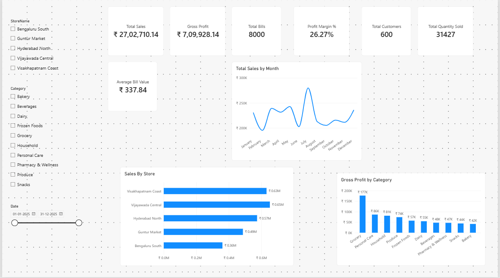
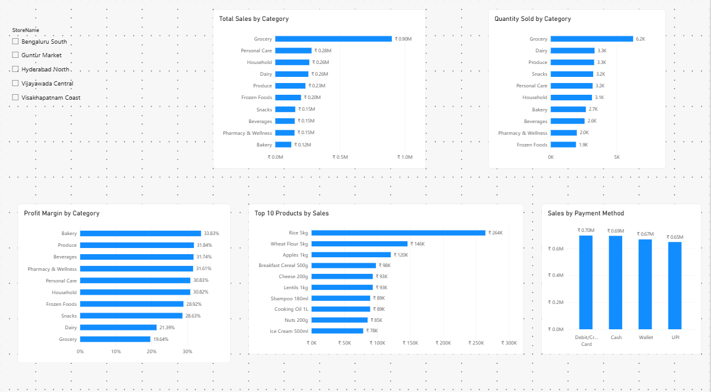
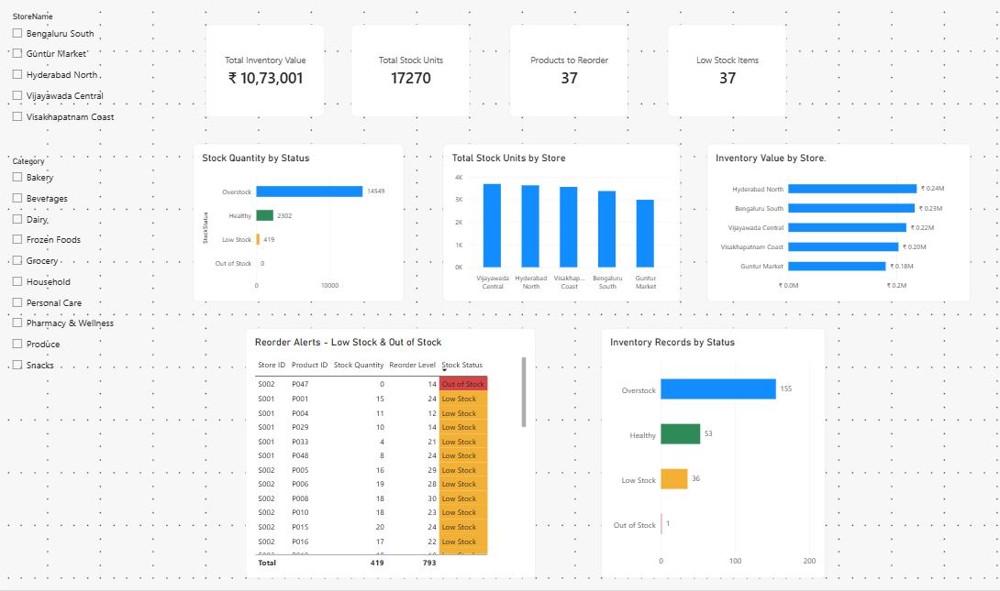

# 🛒 SuperMarket 360 — Power BI Dashboard

An interactive Power BI dashboard for analyzing supermarket performance, product inventory, and stock replenishment requirements.

## 📌 Project Overview

SuperMarket 360 is a Power BI portfolio project designed to demonstrate how business intelligence can help supermarket teams monitor inventory, identify stock shortages, and make data-driven replenishment decisions.

The project uses synthetic sample data representing supermarket products and inventory across multiple branches. It is intended for learning and portfolio demonstration, not as a representation of actual business transactions.

## 🎯 Business Objectives

- Monitor key inventory and product KPIs.
- Identify products with low stock or no available stock.
- Compare inventory conditions across branches and products.
- Analyze product stock status using interactive filters.
- Support replenishment planning and inventory monitoring.
- Present business information through an interactive Power BI report.

## 🛠️ Tools and Technologies

- Microsoft Power BI Desktop
- Microsoft Excel / sample dataset
- Power Query
- DAX (Data Analysis Expressions)
- Data modeling
- Interactive charts, KPI cards, and slicers

## 🔄 Dashboard Development Process

### Step 1: Understand the Business Requirements

Identified the main business questions the dashboard should answer:

- Which products require replenishment?
- Which products have low or zero stock?
- How are products distributed across stock-status categories?
- How can users filter the inventory information to investigate specific products or branches?

### Step 2: Prepare the Dataset

Used synthetic sample data for supermarket inventory analysis, including products such as snacks, school bags, and water bottles.

Reviewed the available fields and prepared the dataset for use in Power BI.

### Step 3: Import and Transform Data

Imported the dataset into Power BI Desktop and reviewed the data types and fields required for analysis.

Prepared the data so inventory quantities, product details, and stock-status categories could be used in report visuals.

### Step 4: Define Inventory Status Categories

Used the following stock-status categories in the dashboard:

- **Healthy** — Stock is within the intended operating range.
- **LowStock** — Stock is below the required replenishment threshold.
- **Out of Stock** — No stock is available.
- **OverStock** — Stock exceeds the intended inventory level.

These categories make it easier to identify inventory conditions that may need attention.

### Step 5: Create DAX Measures

Created a DAX measure to count products requiring replenishment.

```DAX
Products to Reorder =
CALCULATE(
    COUNTROWS(Inventory),
    Inventory[StockStatus] IN {
        "LowStock",
        "Out of Stock"
    }
)
```

This measure counts inventory records classified as either `LowStock` or `Out of Stock`.

Other KPI measures were used to summarize the inventory information displayed in the report.

### Step 6: Design the Executive Overview

Built an executive dashboard layout with KPI cards and inventory visuals to provide a quick overview of supermarket stock conditions.

Configured visual formatting and chart labels to make the report easier to understand.

### Step 7: Add Interactive Filtering

Used the StockStatus dropdown slicer to filter inventory by:

- Healthy
- LowStock
- Out of Stock
- OverStock

Interactive filtering allows users to focus on particular inventory conditions during analysis.

### Step 8: Review and Validate the Dashboard

Reviewed the KPI values, chart readability, stock-status categories, and inventory filtering.

During validation, the `Products to Reorder` measure returned 37 records: 36 classified as LowStock and 1 classified as Out of Stock.

This confirmed that the measure included both stock-status categories specified in its DAX definition.

## 📊 Key Dashboard Features

- Inventory KPI cards
- Products requiring replenishment
- Stock-status analysis
- Inventory comparisons across products and branches
- Interactive StockStatus filtering
- Business-focused visual design

## 🖼️ Dashboard Screenshots

### Executive Overview



### Category Analysis



### Inventory Analysis



## 📁 Repository Contents

| File | Description |
|---|---|
| `Super Market Power BI.pbix` | Interactive Power BI report |
| `SuperMarket_360_MultiBranch_Sample_Dataset.xlsx` | Sample dataset |
| `Super_Market_Executive_Overview.png` | Executive dashboard screenshot |
| `Super_Market_Category_Analysis.png` | Category analysis screenshot |
| `Super_Market_Inventory_Analysis.png` | Inventory analysis screenshot |
| `README.md` | Project documentation |

## 💡 Key Learning Outcomes

Through this project, I practiced:

- Preparing data for Power BI reporting.
- Creating DAX measures with `CALCULATE`, `COUNTROWS`, and `IN`.
- Applying business rules to inventory classification.
- Designing KPI cards and interactive visuals.
- Validating measures against underlying inventory counts.
- Presenting inventory information for business decision-making.

## 🚀 How to Explore the Project

1. Open this repository and download the Power BI report file.
2. Download the associated sample dataset if included.
3. Open the report in Power BI Desktop.
4. If prompted, update the data-source path to the location of the downloaded dataset.
5. Refresh the report if required.
6. Explore the dashboard and use the StockStatus slicer to investigate inventory conditions.

## 👤 Author

**Manohar Kuttuboina**  
Aspiring Power BI Developer | Data Analytics Portfolio

This project was developed for learning and portfolio demonstration using synthetic sample data.
